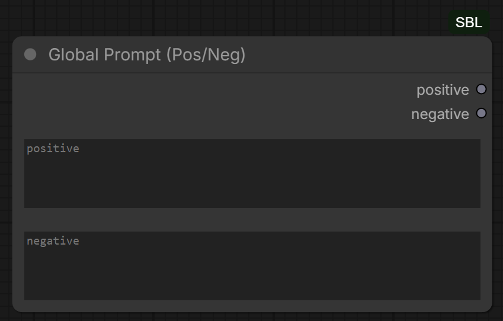
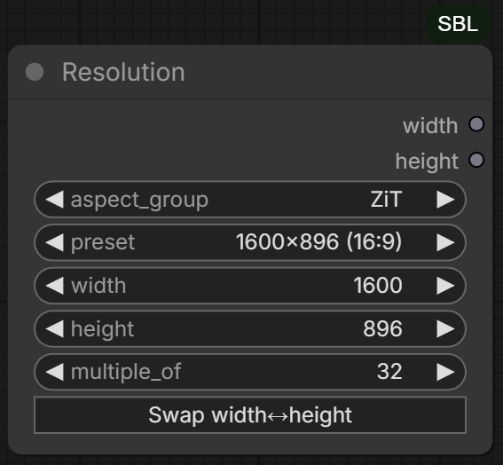
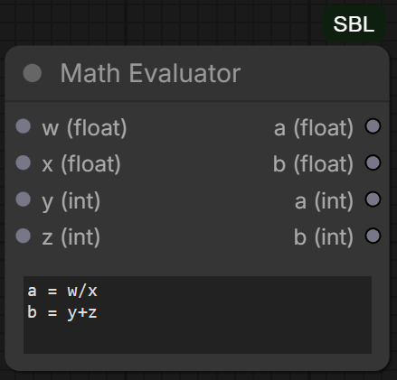
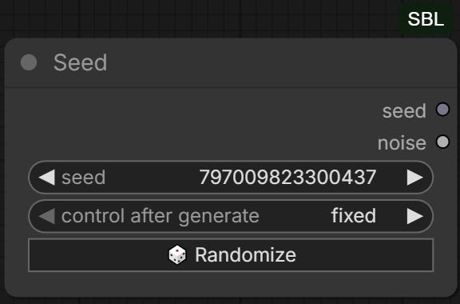
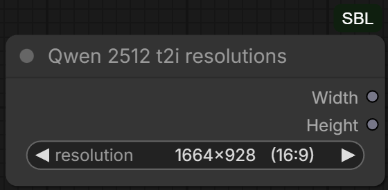
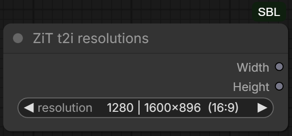
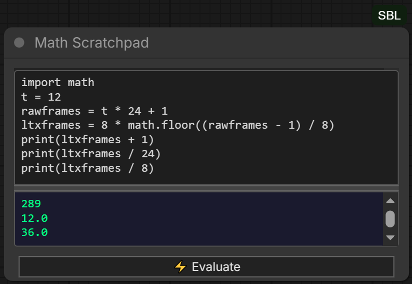

# SBL

SBL is a collection of utility custom nodes for ComfyUI.

## Included nodes

### Global Prompt (Pos/Neg)

Outputs reusable positive and negative prompt strings.



### Resolution

Provides resolution presets, aspect-ratio groups, custom dimensions, and multiple-of snapping.



### Math Evaluator

Evaluates mathematical expressions and small multi-line math programs with float and integer outputs.



### Seed

Outputs a seed and ComfyUI noise object, with a frontend randomize button.



### Qwen 2512 t2i resolutions

Provides preset image resolutions for Qwen 2512 image generation workflows.



### ZiT t2i resolutions

Provides preset image resolutions for ZiT image generation workflows.



### Math Scratchpad

Interactive multi-line mathematical scratchpad with variables, functions, loops, comprehensions, and displayed output.



All nodes appear under the **SBL** category in ComfyUI.

## Installation

### ComfyUI Manager

Install **SBL** through ComfyUI Manager.

### Manual installation

Clone the repository into your ComfyUI `custom_nodes` directory:

```bash
git clone https://github.com/SoftByteLabs/SBL
```

Restart ComfyUI after installation.

## Dependencies

SBL has no additional third-party Python dependencies beyond the packages included with ComfyUI.

## Math safety

The **Math Evaluator** and **Math Scratchpad** use a restricted AST-based interpreter rather than Python `exec()` or `eval()`.

They support a broad range of mathematical Python-style syntax while blocking arbitrary code execution, unrestricted imports, filesystem access, subprocess execution, object introspection, and other unsafe operations.

## License

Copyright © 2026 SoftByteLabs

SBL is free software licensed under the **GNU General Public License v3.0 or later**.

You may use, study, modify, and redistribute SBL under the terms of the GPL. Redistributed copies and modified versions must preserve the applicable copyright and license notices and remain available under the GPL terms.

See the `LICENSE` file for the full license text.
